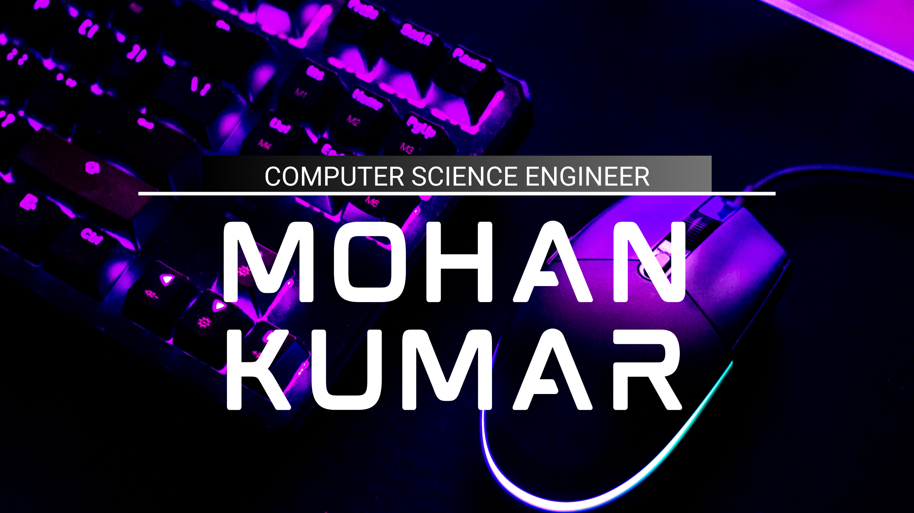

<h1 align="center">
  
</h1>

  

  <h2>Software Developer | Full-Stack Engineering | AI & Cloud Technologies</h2>

  

    Building scalable applications, backend systems, automation solutions and AI-powered applications.
  

  

    
    
  

  
  
  
  

---

## 👨‍💻 About Me

- 💻 Software developer passionate about building practical and scalable software solutions.
- ⚙️ Interested in backend engineering, REST APIs and microservices architecture.
- ☁️ Working with cloud infrastructure, containerization and CI/CD automation.
- 🤖 Exploring AI/ML, intelligent automation and AI-powered applications.
- 🔐 Interested in cybersecurity, system design and emerging technologies.
- 🚀 Always learning, building and improving my engineering skills.

---

## 🛠️ Technical Skills

### 💻 Programming Languages

  

### 🎨 Frontend Development

  

### ⚙️ Backend Development & Databases

  

### ☁️ Cloud, DevOps & Infrastructure

  

### 🤖 AI, Data & Development Tools

  

---

## 🚀 Projects & Engineering

Some of the areas I enjoy building and exploring:

| Area | Focus |
|---|---|
| Backend Engineering | REST APIs, Node.js, Java, Spring Boot |
| Microservices | Distributed applications and service integration |
| Cloud & DevOps | AWS, Docker, Kubernetes, CI/CD |
| AI & Machine Learning | Intelligent applications and automation |
| Full-Stack Development | Angular, JavaScript and backend integration |
| Automation | Workflow automation and testing solutions |

---

## 📺 Latest YouTube Videos

 

---

## 📊 GitHub Statistics

  

  

  

---

<h2 align="center">🐍 Contribution Activity</h2>

  

---

## 🤝 Let's Connect

I'm always open to connecting with developers, exploring new technologies and collaborating on interesting projects.

  

### 💡 Building | Learning | Innovating

<i>"Great software is built one thoughtful commit at a time."</i>

